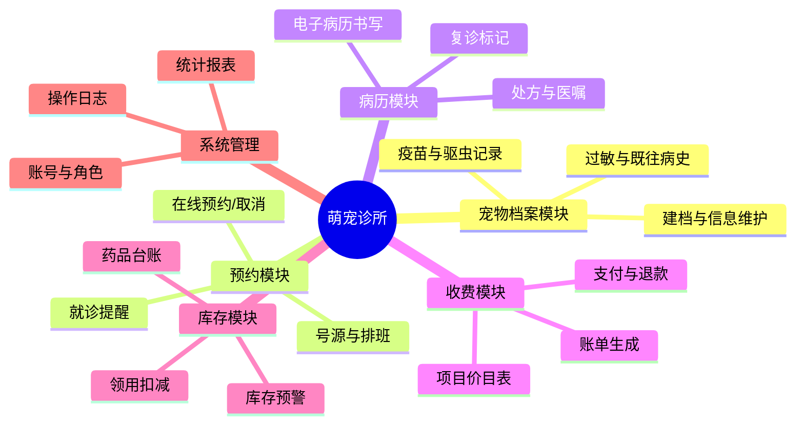
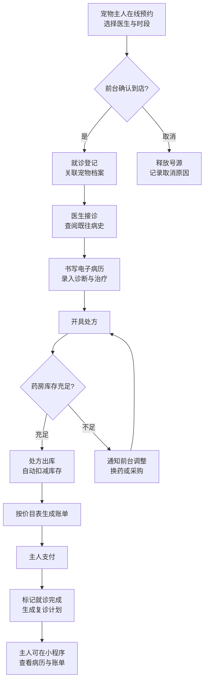

# 🐾 萌宠诊所 · 宠物医院管理系统

> 微服务课程学期项目 | 一个从单体逐步演进为微服务的宠物医院管理平台

| 项目信息 | 说明 |
| --- | --- |
| **课程** | 微服务课程（Microservices） |
| **姓名 / 学号** | 倪金博 / 2412190727 |
| **GitHub** | [nijinbo916](https://github.com/nijinbo916) |
| **项目性质** | 本课程唯一使用的个人项目，学期内持续演进 |
| **技术栈（当前）** | Java 27 · Maven · Spring Boot（后续引入） |

---

## 一、项目简介与业务背景

### 1.1 要解决的实际问题

身边带宠物去诊所的经历大致都是这样的：预约靠打电话或在微信上反复问"明天有没有号"，到了店里还要重新描述宠物的情况；宠物打过什么疫苗、对什么药过敏，全凭一张纸质病历卡，丢了就没了；收费时项目价格不透明，主人对账单有疑问也只能口头解释；药品用完了前台才发现，临时让主人换药。

**萌宠诊所系统要做的，就是把"预约 → 接诊 → 病历 → 处方 → 收费"这条完整业务链搬到线上**，让宠物主人、医生和管理员各有一套清晰的操作界面，所有数据沉淀在系统里，可查、可追、可统计。

### 1.2 目标用户及其需求

| 用户角色 | 核心需求 |
| --- | --- |
| 🧑 宠物主人 | 在线预约、随时查看宠物健康档案和历史病历、账单明细透明、收到就诊提醒 |
| 🩺 医生 / 护士 | 查看当日排班和预约队列、读写电子病历、开具处方、标记复诊 |
| 🗂️ 前台 / 管理员 | 管理医生排班和号源、办理登记与收费、维护药品库存、查看经营统计报表 |

### 1.3 选择这个题目的原因

1. **业务链完整且人人熟悉**：预约、接诊、收费每个环节都有真实痛点，不用编故事就能讲清楚需求。
2. **天然多角色**：主人、医生、管理员三套视角互不相同，后续做认证授权（JWT / RBAC）有现成的落点。
3. **模块边界清晰**：预约、病历、收费、库存天然是独立领域，适合后期逐个拆成微服务。
4. **有真实的一致性问题**：比如"同一时段号源不能超卖""收费与病历必须一致"，为消息队列、分布式事务（Saga）等课程内容提供了练习场景。

### 1.4 项目边界（初期）

**做**：单家诊所内部的预约、就诊、病历、收费、库存管理。
**不做（初期）**：多门店连锁、线上售药电商、医保/宠物保险对接、第三方宠物社区。

---

## 二、功能设计

### 2.1 功能模块总览



### 2.2 模块与功能点明细

| 功能模块 | 包含的具体功能 | 主要服务角色 |
| --- | --- | --- |
| **宠物档案** | 宠物建档（品种/年龄/体重/芯片号）、疫苗与驱虫记录、过敏史与既往病史、档案变更历史 | 主人、医生 |
| **预约管理** | 医生排班与号源管理、在线预约/改约/取消、预约状态流转（待到店/已完成/已取消）、就诊前提醒 | 主人、医生、管理员 |
| **病历管理** | 就诊登记、医生书写电子病历（主诉/诊断/治疗）、开具处方与医嘱、复诊计划 | 医生 |
| **收费结算** | 诊疗项目价目表、按处方自动生成账单、支付（现金/扫码）与退款、账单明细查询 | 管理员、主人 |
| **药品库存** | 药品入库与领用、处方出库自动扣减、低库存预警 | 管理员、医生 |
| **系统管理** | 账号与角色权限管理、经营统计（接诊量/营收/药品消耗）、操作日志审计 | 管理员 |

### 2.3 核心业务流程：一次完整的就诊



这条流程串起了**预约、档案、病历、库存、收费**五个模块，是系统最核心的主干流程，后续数据库设计和服务拆分都会围绕它展开。

---

## 三、当前范围与后续演进方向

### 3.1 当前阶段（第 2 周）

- ✅ 完成选题与功能规划（本文档）
- ⬜ 尚未编写 Java 代码，当前仓库仅包含文档与规划

### 3.2 明确暂不实现的内容

| 暂不实现 | 原因 |
| --- | --- |
| 多门店连锁与分店管理 | 超出单诊所业务边界，增加复杂度但对课程目标无增益 |
| 线上药品电商与配送 | 与"医院管理"主线偏离，属于另一个业务域 |
| 宠物保险理赔对接 | 依赖外部保险机构接口，课程内无法真实联调 |
| 买家社交/社区功能 | 非核心业务，避免功能蔓延 |

### 3.3 面向后续课程的演进规划

| 课程主题 | 在本项目中的落点 |
| --- | --- |
| **数据库持久化** | 宠物档案、预约、病历、账单的表设计与 JPA/MyBatis 持久化 |
| **认证与授权** | 主人/医生/管理员三种角色的登录鉴权，基于 JWT + RBAC 的接口权限控制 |
| **服务拆分** | 按模块边界逐步拆为：预约服务、病历服务、收费服务、库存服务、档案服务 |
| **消息队列** | 预约成功提醒、低库存预警、账单生成等异步事件通知 |
| **分布式事务** | "处方出库 + 收费入账"的最终一致性（Saga / 本地消息表） |
| **监控与可观测性** | 接诊量/接口耗时监控，健康检查与日志聚合 |
| **部署** | Docker Compose 一键部署，后续容器编排与 CI/CD |

---

## 四、运行说明

### 4.1 环境要求

| 要求 | 版本 / 说明 |
| --- | --- |
| Java | 25+（开发机实际使用 JDK 27 运行，编译目标为 Java 25） |
| Maven | 无需本机安装，使用工程自带的 Maven Wrapper（`./mvnw`） |
| Spring Boot | 4.0.8 |
| 数据库 | MySQL 8.x（课程要求）；无 MySQL 时可用 H2 内存库快速演示（`h2` profile） |
| 端口 | 8080（默认端口，未做修改） |

### 4.2 本地 MySQL 的安装、建库与连接配置

**① 安装 MySQL 8.x**（二选一）

- 安装包方式：从 https://dev.mysql.com/downloads/installer/ 下载 MySQL Community Server，安装过程中将 root 密码设为 `root`（或记住自设密码，用环境变量覆盖默认配置）。
- Docker 方式（可选，非必需）：
  ```bash
  docker run -d --name mysql-petclinic -p 3306:3306 -e MYSQL_ROOT_PASSWORD=root -e MYSQL_DATABASE=petclinic mysql:8
  ```

**② 建库**（字符集务必使用 utf8mb4，宠物名含中文）

```sql
CREATE DATABASE IF NOT EXISTS petclinic DEFAULT CHARACTER SET utf8mb4 DEFAULT COLLATE utf8mb4_unicode_ci;
```

完整建表 DDL 见 [docs/database.md](docs/database.md)；日常开发由 Hibernate `ddl-auto=update` 自动建表。

**③ 导入种子数据**（3 名医生，可选）

```bash
mysql -u root -p petclinic < monolith/src/main/resources/data.sql
```

**④ 连接配置**：`monolith/src/main/resources/application.yml` 默认连接 `localhost:3306/petclinic`，
账号 `root` / 密码 `root`；可用环境变量覆盖而不必改文件：

| 环境变量 | 默认值 | 说明 |
| --- | --- | --- |
| `DB_URL` | `jdbc:mysql://localhost:3306/petclinic?...` | JDBC 连接串 |
| `DB_USERNAME` | `root` | 数据库用户名 |
| `DB_PASSWORD` | `root` | 数据库密码 |

### 4.3 启动与测试命令

```bash
# 进入单体工程目录
cd monolith

# 方式一（课程要求）：连接本地 MySQL 启动
./mvnw spring-boot:run
# Windows CMD/PowerShell 使用：mvnw.cmd spring-boot:run

# 方式二（本机暂无 MySQL 时）：H2 内存库快速演示，含种子医生数据
./mvnw spring-boot:run -Dspring-boot.run.profiles=h2

# 运行测试（24 个用例覆盖 Repository / Service / API 三层；
# 测试自动使用 H2 内存库，不依赖本机 MySQL，可重复运行）
./mvnw test
```

### 4.4 REST API 一览与 curl 示例

| 方法 | 路径 | 说明 | 成功 | 失败 |
| --- | --- | --- | --- | --- |
| POST | `/api/pets` | 宠物建档 | 201 | 400 |
| GET | `/api/pets` / `/api/pets/{id}` | 宠物列表 / 详情 | 200 | 404 |
| GET | `/api/doctors` / `/api/doctors/{id}` | 医生列表 / 详情 | 200 | 404 |
| POST | `/api/appointments` | 创建预约（含号源规则校验） | 201 | 400 / 404 / 409 |
| GET | `/api/appointments` | 预约列表（`?petId=` / `?doctorId=`） | 200 | — |
| GET | `/api/appointments/{id}` | 预约详情 | 200 | 404 |
| POST | `/api/appointments/{id}/cancel` | 取消预约（释放号源） | 200 | 404 / 409 |
| GET | `/api/hello`、`/actuator/health` | 运行状态验证 / 健康检查 | 200 | — |

可直接运行的 curl 示例（应用启动后执行）：

```bash
# 示例 1：为宠物建档 → 201 Created，响应体含生成的 id
curl -i -X POST http://localhost:8080/api/pets \
  -H "Content-Type: application/json" \
  -d '{"name":"豆豆","species":"犬","breed":"金毛","ownerName":"倪先生","ownerPhone":"13800000001","birthday":"2021-05-20","weightKg":28.50,"allergyHistory":"青霉素过敏"}'

# 示例 2：创建预约 → 201 Created；若该医生该时段已有有效预约，返回 409 号源冲突
curl -i -X POST http://localhost:8080/api/appointments \
  -H "Content-Type: application/json" \
  -d '{"petId":1,"doctorId":1,"slotStart":"2026-10-19T10:00:00","slotEnd":"2026-10-19T10:30:00","reason":"食欲不振，需要检查"}'

# 示例 3：按宠物查询预约列表 → 200
curl -i "http://localhost:8080/api/appointments?petId=1"

# 示例 4：取消预约 → 200，状态变为 CANCELED，号源随之释放
curl -i -X POST http://localhost:8080/api/appointments/1/cancel
```

### 4.5 当前尚未实现的业务能力

第 4 周已完成「预约」主流程的建模、分层实现与持久化，**尚未实现**以下内容（按课程进度后续完成）：

- 就诊链后半段：到店登记、电子病历（`MedicalRecord`）、处方（`Prescription`）、收费账单
- 宠物档案的修改 / 注销、医生排班管理
- 认证与授权（JWT + RBAC，主人 / 医生 / 管理员三种角色）
- 预约提醒、库存预警等消息通知；分布式事务、服务拆分、服务注册与网关
- 监控与日志聚合、容器化部署

选题与功能规划见 [docs/project-proposal.md](docs/project-proposal.md)，数据库设计见 [docs/database.md](docs/database.md)；
第 3 周工程与运行验证记录见 [docs/homework/week-03/index.md](docs/homework/week-03/index.md)，
第 4 周实现记录见 [docs/homework/week-04/index.md](docs/homework/week-04/index.md)。

---

## 附：仓库说明

### 目录结构

```
.
├── README.md                     # 项目入口：背景、功能设计、运行说明与演进方向
├── monolith/                     # 第 03 周创建的单体 Spring Boot 工程（可独立运行）
│   ├── pom.xml                   # Spring Boot 4.0.8 + Java 25 + Web/JPA/Validation/Actuator + MySQL/H2
│   ├── mvnw / mvnw.cmd           # Maven Wrapper
│   └── src/
│       ├── main/java/com/zjgsu/njb/
│       │   ├── domain/           # 实体：Pet / Doctor / Appointment（JPA 映射）
│       │   ├── dto/              # 请求/响应对象（record + 参数校验）
│       │   ├── repository/       # Spring Data JPA 数据访问（含号源规则查询）
│       │   ├── service/          # 业务层（预约业务规则在此实现）
│       │   ├── web/              # REST Controller（/api/pets、/api/appointments、/api/doctors）
│       │   └── exception/        # 全局异常：409 业务规则 / 404 / 400
│       ├── main/resources/       # application.yml（MySQL）、application-h2.yml、data.sql
│       └── test/                 # Repository / Service / API 三层测试（H2，可重复）
├── docs/
│   ├── project-proposal.md       # 项目提案：业务流程、实体模型、业务规则（按周更新）
│   ├── database.md               # 数据库设计：表结构、约束、索引与建表 DDL
│   └── homework/
│       ├── week-01/              # 第 1 周：环境检查与概念回答
│       ├── week-02/              # 第 2 周：项目选题与功能规划
│       ├── week-03/              # 第 3 周：Spring Boot 工程创建与运行验证
│       └── week-04/              # 第 4 周：业务建模、分层实现与数据库持久化
└── src/                          # （历史占位目录，后续服务拆分时使用）
```

### 开发环境一览（第 1 周检查结果）

| 工具 | 版本 |
| --- | --- |
| Java | 27 (Oracle JDK) |
| Maven | 3.9.16 |
| Git | 2.55.0.windows.3 |
| Docker | 29.8.0（Docker Desktop 4.92.0） |
| Docker Compose | v5.5.1 |

详细环境检查与微服务概念回答见 [docs/homework/week-01/index.md](docs/homework/week-01/index.md)，
第 2 周选题与规划记录见 [docs/homework/week-02/index.md](docs/homework/week-02/index.md)。
