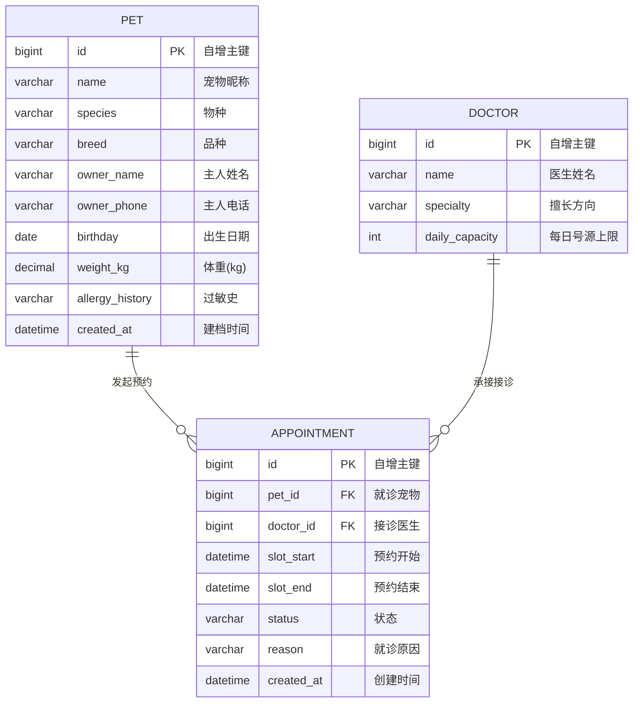

# 数据库设计（Database Design）

- **项目**：萌宠诊所 · 宠物医院管理系统
- **模块**：`monolith/`（单体应用）
- **数据库**：MySQL 8.x（字符集 `utf8mb4`，排序规则 `utf8mb4_unicode_ci`）
- **持久化框架**：Spring Data JPA + Hibernate
- **文档更新日期**：2026-10-12（第 04 周）

---

## 一、本周落地范围

第 04 周实现**一条完整业务流程**：**「宠物主人为宠物预约就诊」**。

围绕该流程落地 3 张业务表：

| 表名 | 说明 | 与流程的关系 |
| --- | --- | --- |
| `pet` | 宠物档案 | 流程主体：谁来看病 |
| `doctor` | 医生（号源提供方） | 流程资源：谁来接诊、每天放多少号 |
| `appointment` | 预约单 | 流程载体：把宠物、医生、时段三件事绑定 |

## 二、实体关系（ER）



**关系说明**

- `appointment.pet_id` → `pet.id`：**多对一**。一只宠物可以有多条预约记录。
- `appointment.doctor_id` → `doctor.id`：**多对一**。一位医生可以承接多条预约。
- 两张外键均为 `NOT NULL`，从数据层面保证「不会有脱离宠物或医生的孤立预约」。

## 三、表结构详细设计

### 3.1 `pet` —— 宠物档案表

| 字段 | 类型 | 允许空 | 约束 / 说明 |
| --- | --- | --- | --- |
| `id` | BIGINT | 否 | **主键**，`AUTO_INCREMENT` |
| `name` | VARCHAR(50) | 否 | 宠物昵称 |
| `species` | VARCHAR(20) | 否 | 物种，如 犬 / 猫 / 兔 |
| `breed` | VARCHAR(50) | 是 | 品种，主人不一定知道 |
| `owner_name` | VARCHAR(50) | 否 | 主人姓名 |
| `owner_phone` | VARCHAR(20) | 是 | 用于就诊提醒 |
| `birthday` | DATE | 是 | 出生日期 |
| `weight_kg` | DECIMAL(5,2) | 是 | 体重（kg），**用药剂量计算依赖**，故用定点数而非浮点 |
| `allergy_history` | VARCHAR(255) | 是 | 过敏史，**开处方前必须确认**，关系到用药安全 |
| `created_at` | DATETIME | 否 | 建档时间 |

### 3.2 `doctor` —— 医生表

| 字段 | 类型 | 允许空 | 约束 / 说明 |
| --- | --- | --- | --- |
| `id` | BIGINT | 否 | **主键**，`AUTO_INCREMENT` |
| `name` | VARCHAR(50) | 否 | 医生姓名 |
| `specialty` | VARCHAR(50) | 是 | 擅长方向，如 内科 / 外科 / 影像 |
| `daily_capacity` | INT | 否 | **每日号源上限**，是「号源超卖」业务规则的判定依据 |

### 3.3 `appointment` —— 预约表

| 字段 | 类型 | 允许空 | 约束 / 说明 |
| --- | --- | --- | --- |
| `id` | BIGINT | 否 | **主键**，`AUTO_INCREMENT` |
| `pet_id` | BIGINT | 否 | **外键** → `pet(id)`，就诊宠物 |
| `doctor_id` | BIGINT | 否 | **外键** → `doctor(id)`，接诊医生 |
| `slot_start` | DATETIME | 否 | 预约时段开始 |
| `slot_end` | DATETIME | 否 | 预约时段结束 |
| `status` | VARCHAR(20) | 否 | 枚举存字符串：`BOOKED` / `CHECKED_IN` / `COMPLETED` / `CANCELED` |
| `reason` | VARCHAR(255) | 是 | 就诊原因（主人自述） |
| `created_at` | DATETIME | 否 | 创建时间 |

**约束与索引设计**

| 约束 / 索引 | 目的 |
| --- | --- |
| `PRIMARY KEY (id)` × 3 表 | 唯一标识每一行 |
| `FOREIGN KEY (pet_id) REFERENCES pet(id)` | 预约必须挂在已建档的宠物上 |
| `FOREIGN KEY (doctor_id) REFERENCES doctor(id)` | 预约必须挂在实际存在的医生上 |
| `NOT NULL` on `pet_id` / `doctor_id` / `slot_start` / `slot_end` / `status` | 业务上不允许出现残缺预约 |
| `status` 存枚举字符串（非序号） | 可读性优先，避免序号与枚举顺序耦合 |
| 建议索引 `idx_appointment_doctor_slot (doctor_id, slot_start, slot_end)` | 支撑「号源重叠检测」查询，见下文 |

> **为什么不用数据库唯一约束直接挡住重复预约？**
> 因为「时段重叠」是区间比较（`已有.start < 新.end AND 已有.end > 新.start`），
> 不是简单的等值比较，唯一索引无法表达。同时取消后的预约不应再占用号源，
> 而唯一约束无法感知状态。因此该规则在 Service 层通过查询实现，
> 数据库层面用普通索引保证查询效率。

## 四、建表 DDL（MySQL 8）

> Hibernate 配置为 `ddl-auto=update`，启动时会按实体自动建表。
> 以下为等价的、可手工执行的建表语句，便于在数据库客户端中复核表结构。

```sql
CREATE DATABASE IF NOT EXISTS petclinic
    DEFAULT CHARACTER SET utf8mb4
    DEFAULT COLLATE utf8mb4_unicode_ci;

USE petclinic;

-- 宠物档案
CREATE TABLE IF NOT EXISTS pet (
    id              BIGINT       NOT NULL AUTO_INCREMENT,
    name            VARCHAR(50)  NOT NULL COMMENT '宠物昵称',
    species         VARCHAR(20)  NOT NULL COMMENT '物种',
    breed           VARCHAR(50)  NULL     COMMENT '品种',
    owner_name      VARCHAR(50)  NOT NULL COMMENT '主人姓名',
    owner_phone     VARCHAR(20)  NULL     COMMENT '主人联系电话',
    birthday        DATE         NULL     COMMENT '出生日期',
    weight_kg       DECIMAL(5,2) NULL     COMMENT '体重(kg)',
    allergy_history VARCHAR(255) NULL     COMMENT '过敏史',
    created_at      DATETIME     NOT NULL COMMENT '建档时间',
    PRIMARY KEY (id),
    KEY idx_pet_owner_name (owner_name),
    KEY idx_pet_species (species)
) ENGINE = InnoDB DEFAULT CHARSET = utf8mb4 COMMENT = '宠物档案';

-- 医生
CREATE TABLE IF NOT EXISTS doctor (
    id             BIGINT      NOT NULL AUTO_INCREMENT,
    name           VARCHAR(50) NOT NULL COMMENT '医生姓名',
    specialty      VARCHAR(50) NULL     COMMENT '擅长方向',
    daily_capacity INT         NOT NULL COMMENT '每日号源上限',
    PRIMARY KEY (id),
    KEY idx_doctor_specialty (specialty)
) ENGINE = InnoDB DEFAULT CHARSET = utf8mb4 COMMENT = '医生';

-- 预约
CREATE TABLE IF NOT EXISTS appointment (
    id         BIGINT       NOT NULL AUTO_INCREMENT,
    pet_id     BIGINT       NOT NULL COMMENT '就诊宠物',
    doctor_id  BIGINT       NOT NULL COMMENT '接诊医生',
    slot_start DATETIME     NOT NULL COMMENT '预约开始时间',
    slot_end   DATETIME     NOT NULL COMMENT '预约结束时间',
    status     VARCHAR(20)  NOT NULL COMMENT 'BOOKED/CHECKED_IN/COMPLETED/CANCELED',
    reason     VARCHAR(255) NULL     COMMENT '就诊原因',
    created_at DATETIME     NOT NULL COMMENT '创建时间',
    PRIMARY KEY (id),
    KEY idx_appointment_doctor_slot (doctor_id, slot_start, slot_end),
    KEY idx_appointment_pet (pet_id),
    CONSTRAINT fk_appointment_pet    FOREIGN KEY (pet_id)    REFERENCES pet (id),
    CONSTRAINT fk_appointment_doctor FOREIGN KEY (doctor_id) REFERENCES doctor (id)
) ENGINE = InnoDB DEFAULT CHARSET = utf8mb4 COMMENT = '预约单';
```

## 五、种子数据

`monolith/src/main/resources/data.sql` 提供 3 名医生的基础数据，
内嵌数据库（H2，测试与演示）启动时自动执行；MySQL 环境手工执行一次即可：

```bash
mysql -u root -p petclinic < monolith/src/main/resources/data.sql
```

## 六、业务规则与表结构的对应关系

| 业务规则 | 落在哪一层 | 依赖的表/字段 |
| --- | --- | --- |
| 预约时间必须是未来 | 请求参数校验（`@Future`） | `appointment.slot_start` |
| 结束时间必须晚于开始时间 | Service | `slot_start`、`slot_end` |
| **同一医生同一时段不可重复预约** | Service（Repository 重叠统计查询） | `appointment(doctor_id, slot_start, slot_end, status)` |
| **某医生当日预约数不超过号源上限** | Service | `appointment` + `doctor.daily_capacity` |
| 已取消/已完成的预约不能再次取消 | Service（状态机） | `appointment.status` |
| 预约必须关联已建档宠物 | 数据库外键 + Service 校验 | `appointment.pet_id` → `pet.id` |

## 七、后续演进

| 周次主题 | 数据库侧计划 |
| --- | --- |
| 病历与处方 | 新增 `medical_record`、`prescription` 表，与 `appointment` 一对一 |
| 收费结算 | 新增 `bill`、`bill_item` 表，处方出库与收费入账需保证一致性（后续分布式事务） |
| 药品库存 | 新增 `medicine`、`stock_log` 表 |
| 认证授权 | 新增 `sys_user`、`role`、`user_role` 表，宠物主人/医生/管理员按角色授权 |
| 服务拆分 | 按模块边界拆分数据表归属：预约库、病历库、收费库、库存库，跨库查询改为服务调用 |
