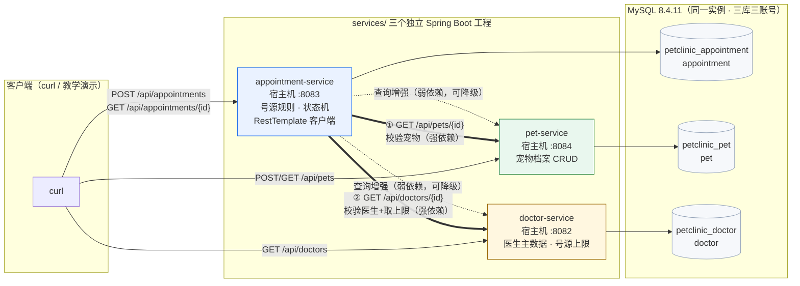

# 微服务拆分设计（萌宠诊所 · 宠物医院管理系统）

- **姓名**：倪金博　**学号**：2412190727
- **日期**：2026-10-26
- **单体版本**：`monolith/`（保留不动，第 04/05 周作业的完整实现）
- **微服务版本**：`services/`（本周新增，三个独立 Spring Boot 工程）

---

## 一、单体模块 → 微服务的拆分映射

单体里围绕「宠物档案」「医生与号源」「预约流程」三个内聚职责展开（见 `docs/project-proposal.md`）。
三者变更节奏和数据归属完全不同：宠物档案由主人维护、医生数据由诊所维护且基本只读、
预约是高频写入且有号源规则——因此按数据归属切三条线，而不是按技术分层切。

| 单体模块（com.zjgsu.njb.*） | 拆入的微服务 | 理由 |
| --- | --- | --- |
| `domain/Pet`、`PetRepository`、`PetService`、`PetController`、宠物相关 DTO | **pet-service** | 宠物档案是独立的数据资产：建档、查档、改档都只围绕 pet 表，被预约和将来的病历/处方引用 |
| `domain/Doctor`、`DoctorRepository`、`DoctorService`、`DoctorController`、`DoctorResponse` | **doctor-service** | 医生主数据由诊所维护、低频变更、多方只读，是典型的独立主数据服务 |
| `domain/Appointment`、`AppointmentStatus`、`AppointmentRepository`、`AppointmentService`、`AppointmentController`、预约 DTO | **appointment-service** | 预约是核心业务流程与全部业务规则（号源防冲突、每日上限、状态机）所在，写入量大、规则演进快 |
| `exception/*`（全局异常） | 三个服务各持一份 | 每个服务独立部署，异常 → HTTP 状态码的映射必须自带，不能共享库 |
| `domain/MedicalRecord` 等未来模块 | 暂不拆 | 就诊链后半段（病历/处方）属第 07 周以后内容，避免过度设计 |

## 二、服务清单：职责、端口、数据库、数据表

| 服务 | 端口（容器内 8080，宿主机映射如下） | 独立数据库 | 拥有的数据表 | 职责 |
| --- | --- | --- | --- | --- |
| `services/pet-service/` | **8084** | (`petclinic_pet`) | `pet` | 宠物档案：建档、列表、详情。是宠物数据的唯一权威来源（single source of truth） |
| `services/doctor-service/` | **8082** | `petclinic_doctor` | `doctor` | 医生主数据与每日号源上限（`daily_capacity`），提供医生存在性校验 |
| `services/appointment-service/` | **8083** | `petclinic_appointment` | `appointment` | 预约流程与全部号源规则；创建预约前通过 HTTP 校验宠物与医生 |

三个服务共用一个 MySQL 8.4.11 实例（`compose.yaml` 中单容器、初始化脚本建库建账号），
但**库、账号、表完全隔离**：`pet_user` 只能读写 `petclinic_pet`，其余同理。
数据归属原则：**每个服务只读写自己的表，绝不跨库 JOIN、不建跨库外键、不调别人的 Repository。**

## 三、服务间调用关系

```
appointment-service ──HTTP──> pet-service      （创建预约前校验宠物存在，GET /api/pets/{id}）
appointment-service ──HTTP──> doctor-service   （校验医生存在并取 daily_capacity，GET /api/doctors/{id}）
查询类接口做展示增强时也会调上述两个接口（失败降级为“服务暂不可用”，不影响主数据返回）
pet-service / doctor-service 之间：无调用（互不依赖）
```

### 跨服务协作的关键设计（预约创建流程）

1. appointment-service 收到 `POST /api/appointments`；
2. **RestTemplate 同步调用** pet-service 校验宠物，返回 404 则本次预约直接失败（404），
   **不写入本地任何数据**；
3. 同样调用 doctor-service 校验医生并取得 `dailyCapacity`，医生不存在 → 404；
4. 校验通过后按本地 `appointment` 表做号源规则（同时段冲突 → 409、每日上限 → 409），
   落库时**只存 `petId` / `doctorId` 两个 ID**（跨服务关联只保存对方 ID）；
5. pet-service 或 doctor-service **不可达**时，抛出 503（`DEPENDENCY_UNAVAILABLE`），
   同样不落库 —— 绝不跳过校验继续写数据。

RestTemplate 的连接/读取超时均为 3s/5s，服务地址写在 `application.yml`
（`pet.base-url` / `doctor.base-url`），可用环境变量 `PET_SERVICE_URL` / `DOCTOR_SERVICE_URL` 覆盖
（compose 中即用 `http://pet:8080`、`http://doctor:8080` 按服务名访问）。

### 查询时的展示增强与降级

`GET /api/appointments/{id}` 返回的 `petName`、`doctorName` 等展示字段，
由 appointment-service 调用两个服务拼装；任一远端失败时该字段降级为
`"(pet-service 暂不可用)"` 之类的占位并照常返回预约本体 —— 查询不强依赖远端，写入强依赖。

## 四、架构图



要点：三个库之间的虚线表示「只通过 HTTP API 获取对方信息」，数据库层没有任何跨库引用；
`appointment` 表中的 `pet_id` / `doctor_id` 是普通 BIGINT 列（逻辑外键），不是数据库外键。

## 五、「远端成功、本地失败」窗口（第 4 小题要求预判）

以「创建预约」为例，跨服务流程存在两个非原子窗口：

1. **校验通过后、本地落库前**：远端校验（宠物/医生存在）已成功，但本地事务还没提交时进程崩溃 →
   远端无副作用、本地无数据，客户端收到错误后重试即可，属于安全窗口；
2. **本地落库成功后、响应返回前**：预约已写入 `petclinic_appointment`，但 HTTP 响应丢失
   （超时/断连）→ 客户端不知道成功而重试，第二次大概率命中「号源冲突 409」或产生重复预约。
   这就是典型的**远端（本地库）成功、客户端感知失败**窗口。

本周按课程要求**不实现**跨服务原子事务、自动补偿或消息机制，只在文档中识别并说明该窗口；
缓解思路（后续演进方向）：客户端携带幂等键（idempotency key）、或用本地消息表 + 最终一致。

## 六、保留与新增的边界

| 位置 | 本周处理 |
| --- | --- |
| `monolith/` | **原样保留**，仍是第 04/05 周通过全部验证的单体版本，不改名、不删码 |
| `services/` | 新增三个独立 Spring Boot 工程（各有 `pom.xml`、`src/`、`Dockerfile`、测试） |
| `compose.yaml`（根目录） | 更新为一键启动 mysql + 三个微服务（第 05 周的单体编排被替换，单体仍可单独运行） |
| `scripts/`、`docs/`（根目录） | 仍在仓库根目录；`scripts/smoke-test.sh` 从根目录可直接运行 |
| 基础包名 | 三个服务均为 `com.zjgsu.njb.<service>` 子包，延续 `com.zjgsu.njb`（倪金博缩写） |
