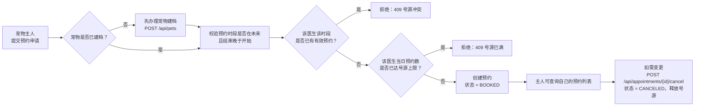
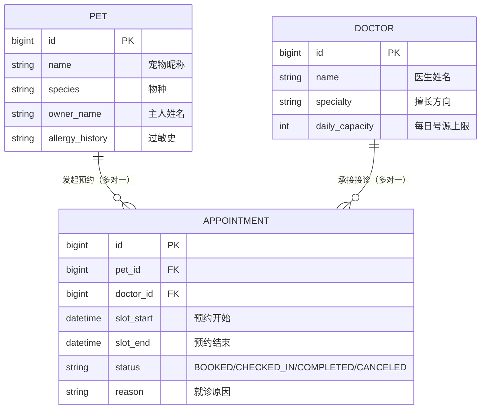

# 项目提案（Project Proposal）

- **姓名**：倪金博
- **学号**：2412190727
- **项目名称**：萌宠诊所 · 宠物医院管理系统
- **基础包名**：`com.zjgsu.njb`
- **文档更新日期**：2026-10-12（第 04 周）

> 选题与第 02 周 README、[week-02 作业文档](../homework/week-02/index.md)保持一致，本学期不再更换题目。
> 本文档按周次持续更新：第 03 周确定工程骨架，第 04 周落实业务建模与持久化。

## 一、项目名称与简述

**萌宠诊所 · 宠物医院管理系统**：把「预约 → 接诊 → 病历 → 处方 → 收费」这条宠物就诊的完整业务链搬到线上，
让宠物主人、医生和管理员各有一套清晰的操作入口，所有数据可查、可追、可统计。

## 二、目标用户及其需求

| 用户角色 | 核心需求 |
| --- | --- |
| 宠物主人 | 在线预约、查看宠物健康档案与历史病历、账单明细透明、收到就诊提醒 |
| 医生 / 护士 | 查看当日排班与预约队列、书写电子病历、开具处方、标记复诊 |
| 前台 / 管理员 | 管理医生排班与号源、办理登记与收费、维护药品库存、查看经营统计 |

## 三、核心业务流程与实体模型（第 04 周）

### 3.1 本周实现的核心业务流程：宠物预约就诊

**流程描述（预约段）**：

该流程是整条就诊链的**入口段**：主人提交预约、系统校验号源、预约单落库。
后续周次会在这条链上继续接上「到店登记 → 医生接诊 → 电子病历 → 处方 → 收费」。

### 3.2 参与流程的业务实体及其关系

本周落地 3 个实体，其中 `Pet` 与 `Appointment` 是流程的两个核心实体，`Doctor` 是号源资源：

| 实体 | 在流程中的角色 | 关系 |
| --- | --- | --- |
| `Pet` 宠物档案 | 流程主体：**谁**来看病 | 一只宠物 → 多条预约（1 : N） |
| `Doctor` 医生 | 流程资源：**谁**接诊、**放多少号** | 一位医生 → 多条预约（1 : N） |
| `Appointment` 预约单 | 流程载体：把宠物、医生、时段绑定在一起 | 多对一指向 `Pet` 与 `Doctor` |

**为什么把「时段」放在预约单上而不是给宠物或医生加字段？**
因为「占用」是宠物与医生之间的**关系属性**，只能存在于连接两者的预约记录里。
把它放在预约单上，同一只宠物找不同医生、同一医生接不同宠物，都不会互相干扰。

### 3.3 需要在 Service 中检查的业务规则

本周在 `AppointmentService` 中实现 4 条规则，其中最核心的一条是：

> **业务规则（核心）：同一医生在同一时段不能存在两条有效预约 —— 防止号源超卖。**
>
> 判定方式：在 `AppointmentRepository` 中按「区间重叠」查询该医生已占用号源的预约数：
> `已有.slotStart < 新.slotEnd AND 已有.slotEnd > 新.slotStart`，
> 且仅统计状态为 `BOOKED` / `CHECKED_IN` 的预约（已取消、已完成的预约会释放号源）。
> 命中时抛出 `BusinessRuleException`，由全局异常处理器转换为 **HTTP 409 Conflict**。

其余 3 条规则：

| # | 规则 | 触发结果 |
| --- | --- | --- |
| 1 | 预约时段必须合法：结束时间晚于开始时间 | 400 Bad Request |
| 2 | 预约开始时间必须在未来（`@Future`） | 400 Bad Request |
| 3 | 某医生当日有效预约数不得超过其 `daily_capacity` | 409 号源已满 |
| 4 | 已取消 / 已完成的预约不能再次取消 | 409 状态非法 |

> 为什么这些规则要写在 Service 而不是数据库唯一约束里？
> 「时段重叠」是区间比较而非等值比较，唯一索引表达不了；同时已取消的预约应当释放号源，
> 而唯一约束无法感知状态。因此规则落在 Service，数据库层用普通索引保证查询效率。

## 四、里程碑与演进路线

| 周次 | 里程碑 | 状态 |
| --- | --- | --- |
| 第 03 周 | 建立可运行的 Spring Boot 工程骨架、`/api/hello` 与健康检查、启动测试 | ✅ 已完成 |
| **第 04 周** | **业务建模 + 分层实现（model / repository / service / controller）+ MySQL 持久化 + 完整测试** | ✅ 本周完成 |
| 第 05 周起 | 病历与处方、认证授权、服务拆分、消息与事务、监控与部署 | ⬜ 待进行 |

| 课程主题 | 在本项目中的落点 |
| --- | --- |
| 数据库持久化（第 04 周） | Pet / Doctor / Appointment 三表设计 + Spring Data JPA 读写 + MySQL 接入 |
| 病历与处方 | 新增 `medical_record`、`prescription`，与预约一对一 |
| 认证与授权 | 主人 / 医生 / 管理员三种角色的登录鉴权（JWT + RBAC） |
| 服务拆分 | 按模块边界拆为：预约服务、病历服务、收费服务、库存服务、档案服务 |
| 消息队列 | 预约成功提醒、低库存预警、账单生成等异步事件通知 |
| 分布式事务 | 「处方出库 + 收费入账」的最终一致性（Saga / 本地消息表） |
| 监控与部署 | 接口监控与日志聚合，Docker Compose 一键部署 |

详细表结构见 [docs/database.md](../database.md)，本周实现记录见 [week-04 作业文档](../homework/week-04/index.md)。
