# 安全设计：API Gateway、JWT 认证与鉴权（第 09 周）

> 本文件回答三个问题：**谁在验身份**、**谁能调什么**、**绕过网关行不行**。
> 代码位置：`services/gateway-service`（网关）、`services/pet-service`（签发 token 的认证服务）。
> 验证脚本：`scripts/auth-test.sh`。

## 一、整体结构

系统对外的端口只有一个：`gateway-service` 的 `8080`。其余服务的宿主机端口全部绑在 `127.0.0.1`，只给本机调试用，局域网和外网访问不到。

```
                          ┌──────────────────────────────┐
   客户端 ── Bearer ────► │  gateway-service :8080       │
                          │  1. 删客户端伪造的 X-Auth-*  │
                          │  2. 验签 JWT（不签发）       │
                          │  3. 查角色规则               │
                          │  4. 注入可信身份 + 网关凭证  │
                          └───────┬──────────┬───────────┘
                                  │          │
                    ┌─────────────┘          └──────────────┐
                    ▼                                       ▼
        ┌───────────────────────┐              ┌────────────────────────┐
        │ pet-service :8080     │              │ doctor-service :8080   │
        │  · /api/pets/**       │              │  · /api/doctors/**     │
        │  · /api/auth/**  签发 │              └────────────────────────┘
        │  · /api/admin/**      │
        │  · 校验网关凭证       │              ┌────────────────────────┐
        └───────────────────────┘              │ appointment-service    │
                                               │  · /api/appointments/**│
                                               └────────────────────────┘
```

**为什么签发放在 pet-service 而不是网关：** 账号表 `sys_user` 属于用户域数据，网关是无状态转发组件，不应该连数据库。网关拿公用的 HS256 密钥只做验签，签发逻辑和账号密码校验都留在认证服务里 —— 网关被攻破也拿不到用户密码。

**为什么用 HS256 而不是 RS256：** 本项目只有一个签发者（pet-service）、一个验签者（网关），对称密钥部署更简单。代价是密钥要同时给两边，所以密钥只能走环境变量，不能进代码、不能进镜像层。

## 二、认证流程

```mermaid
sequenceDiagram
    autonumber
    participant C as 客户端
    participant G as gateway-service
    participant P as pet-service（认证服务）

    C->>G: POST /api/auth/login {username, password}
    Note over G: /api/auth/login 在白名单，直接转发
    G->>P: 转发登录请求
    P->>P: 按用户名查 sys_user
    P->>P: BCrypt.matches(明文, 库里的哈希)
    alt 密码正确
        P->>P: 签发 JWT（sub/uid/roles/iss/exp，HS256）
        P-->>G: 200 {accessToken, tokenType, expiresIn, role}
        G-->>C: 200 同上
    else 密码错误 / 账号不存在 / 账号停用
        P-->>G: 401 INVALID_CREDENTIALS「用户名或密码错误」
        G-->>C: 401 同上（三种原因不区分）
    end

    C->>G: GET /api/pets  Authorization: Bearer <token>
    G->>G: 删除客户端带来的 X-Auth-User / X-Auth-Roles / X-Trusted-Caller
    G->>G: 验签（签名 / iss / exp）
    alt 验签失败或没有 token
        G-->>C: 401（请求不往下走）
    else 验签通过但角色不够
        G-->>C: 403（请求不往下走）
    else 通过
        G->>P: 转发，带 X-Auth-User / X-Auth-Uid / X-Auth-Roles / X-Trusted-Caller
        P->>P: 校验 X-Trusted-Caller 是否等于约定值
        P-->>G: 200 业务数据
        G-->>C: 200
    end
```



## 三、令牌内容

HS256 签名，默认有效期 60 分钟（`JWT_TTL_MINUTES`）。payload 只放三样：

| claim | 含义 | 示例 |
|---|---|---|
| `sub` | 登录名 | `admin` |
| `uid` | 用户 id | `1` |
| `roles` | 角色数组 | `["ADMIN"]` |
| `iss` | 签发者，验签时强校验 | `petclinic-auth` |
| `iat` / `exp` | 签发 / 过期时间 | — |

**刻意不放**手机号、身份证、宠物列表等业务数据：JWT 是 Base64 编码，不是加密，任何人都能解开看。放得越多，泄露越多。需要用户信息时用 `GET /api/auth/me` 现查。

## 四、角色与权限矩阵

三个角色，测试账号见根目录 README。

| 接口 | 方法 | 谁可以访问 | 拦截结果 |
|---|---|---|---|
| `/api/auth/login` | POST | 公开（白名单） | — |
| `/api/health`、`/actuator/health` | GET | 公开（白名单） | — |
| `/api/auth/me` | GET | 任意登录用户 | 无 token → 401 |
| `/api/pets` | GET | 任意登录用户 | 无 token → 401 |
| `/api/pets/{id}` | GET | 任意登录用户 | 无 token → 401 |
| `/api/pets` | POST | `OWNER`、`ADMIN` | `DOCTOR` → 403 |
| `/api/pets/{id}` | DELETE | 仅 `ADMIN` | `OWNER`/`DOCTOR` → 403 |
| `/api/doctors/**` | GET | 任意登录用户 | 无 token → 401 |
| `/api/appointments` | POST | `OWNER`、`DOCTOR`、`ADMIN` | 无 token → 401 |
| `/api/appointments/**` | GET | 任意登录用户 | 无 token → 401 |
| `/api/admin/summary` | GET | 仅 `ADMIN` | `OWNER`/`DOCTOR` → 403 |

规则实现在 `gateway-service` 的 `RolePolicy`，按顺序匹配、先匹配先生效，所以 `DELETE /api/pets/**` 排在 `* /api/**` 兜底规则之前。**默认拒绝**：不在白名单里的 `/api/**` 一律要求登录。

`GET /api/admin/summary` 在服务端还查了一次 `X-Auth-Roles` —— 网关是第一道闸，不是唯一一道，属于纵深防御。

## 五、网关路由表

配置在 `services/gateway-service/src/main/resources/application.yml`，前缀是 `spring.cloud.gateway.server.webflux.routes`（Gateway 5.x 改过前缀，用旧的 `spring.cloud.gateway.routes` 不报错但路由静默失效）。

| # | 路由 id | 路径谓词 | 目标 | 说明 |
|---|---|---|---|---|
| 1 | `pet-service` | `/api/pets/**` | `lb://pet-service` | 宠物档案 |
| 2 | `doctor-service` | `/api/doctors/**` | `lb://doctor-service` | 医生主数据 |
| 3 | `appointment-service` | `/api/appointments/**` | `lb://appointment-service` | 预约流程 |
| 4 | `auth-service` | `/api/auth/**`、`/api/admin/**` | `lb://pet-service` | 登录与用户域管理端 |

目标全部写服务名（`lb://`），实例列表来自 Nacos，网关里没有任何 IP 或端口。多实例时由 Spring Cloud LoadBalancer 选择，扩缩容不用改网关配置。

`/api/health` 由网关自己的 `HealthController` 处理，不转发 —— 探活不应该依赖下游是否健康。

## 六、伪造身份头与绕过网关

### 6.1 客户端伪造身份头

下游服务信任 `X-Auth-User` / `X-Auth-Roles`，如果不做处理，客户端自己加上 `X-Auth-Roles: ADMIN` 就成管理员了。

网关的处理（`GatewayAuthFilter`）：

1. **先删再验**：无论请求是否合法，先移除 `X-Auth-User`、`X-Auth-Uid`、`X-Auth-Roles`、`X-Trusted-Caller` 四个头，**然后**才验签。顺序不能反，反了就等于把伪造的头放行。
2. **验签通过后重新写入**：身份来自 token 的 claims，不是来自请求头。
3. 白名单请求（登录、健康检查）同样先删头，避免伪造头流到下游。

验证方式见 `scripts/auth-test.sh` 第 5 组：用 `owner` 的 token 同时带 `X-Auth-Roles: ADMIN`，结果仍然是 403。

### 6.2 绕过网关直连服务

只做网关鉴权是不够的：如果 `pet-service` 的 8081/8084 端口对外可达，`curl http://host:8084/api/pets` 根本不过网关，也就没有 JWT 校验。

两道防线：

| 层 | 做法 | 效果 |
|---|---|---|
| 网络 | `compose.yaml` 里业务服务端口绑 `127.0.0.1`，只有 gateway 绑 `0.0.0.0:8080` | 外部主机连不上业务端口 |
| 应用 | `pet-service` 的 `GatewayTrustFilter` 校验 `X-Trusted-Caller` | 即使同机直连，没有凭证也 401 |

`X-Trusted-Caller` 的值是 `TRUSTED_CALLER_SECRET`，网关验签通过后写入；客户端自带的会被网关删掉。**跨服务调用**（appointment → pet）不经过网关，由 `appointment-service` 的 Feign 拦截器补上同一个头 —— 否则内部调用会被自己的信任过滤器拒掉。

白名单例外：`/api/auth/login`（登录时还没有 token，不可能带凭证）和 `/actuator/health`（容器探针直连）。

验证方式见 `scripts/auth-test.sh` 第 6 组：直连 8084 无论带不带伪造身份头都是 401，响应体 `error` 为 `DIRECT_ACCESS_DENIED`。

## 七、密码存储

- 算法：BCrypt，强度 10（约 60~80ms 一次，能拖住暴力破解，又不至于让登录明显变慢）。
- 库里只存哈希，形如 `$2a$10$...`，固定 60 字符，**没有明文也没有可逆密文**。
- 每个账号的盐不同（BCrypt 自带随机盐），同一个密码存两次结果也不同，无法用彩虹表批量撞库。
- 登录查询不做「用户名+密码」的 SQL 比对 —— 哈希每次盐不同，SQL 里比不了，只能取出哈希再用 `matches` 校验。
- 用户不存在时也跑一次 BCrypt 比对（对着假哈希），让「用户不存在」和「密码错误」耗时接近，防止靠响应时间枚举用户名。
- 登录失败统一返回「用户名或密码错误」，不区分三种原因。
- 密码长度上限 72 字节：BCrypt 只处理前 72 字节，超长会被静默截断，干脆在入口卡住。

测试账号的初始密码来自环境变量 `APP_SEED_PASSWORD`，账号不存在时才用 BCrypt 现场生成哈希写入，源码里没有写死的可用口令。**这些账号只用于课程演示，真实部署必须改掉。**

## 八、密钥管理

| 变量 | 用途 | 要求 |
|---|---|---|
| `JWT_SECRET` | HS256 签名/验签 | ≥ 32 字节，网关与认证服务**必须一致** |
| `TRUSTED_CALLER_SECRET` | 网关向下游证明身份 | 随机串，网关 / pet / appointment 三处一致 |
| `APP_SEED_PASSWORD` | 测试账号初始密码 | 仅演示用 |

真实值只存在 `.env`（已被 `.gitignore` 忽略），`.env.example` 里是占位符。生成方式：

```bash
openssl rand -base64 48
```

代码里没有可用的默认密钥：`JWT_SECRET` 不足 32 字节时两个服务都直接启动失败，而不是降级成弱密钥跑起来。

## 九、验证

```bash
# 一键跑全套（未登录 / 登录 / 授权 / 越权 / 伪造头 / 直连）
export APP_SEED_PASSWORD='<.env 里的值>'
bash scripts/auth-test.sh

# 只看路由表是否加载
curl -s http://localhost:8080/actuator/gateway/routes | head -c 800

# 手动走一遍
TOKEN=$(curl -s -X POST http://localhost:8080/api/auth/login \
  -H 'Content-Type: application/json' \
  -d '{"username":"admin","password":"<密码>"}' | sed -nE 's/.*"accessToken":"([^"]+)".*/\1/p')
curl -i http://localhost:8080/api/pets -H "Authorization: Bearer $TOKEN"
```

## 十、已知限制

- 令牌无法主动吊销：签发后到期前一直有效。生产环境应加短期 access token + refresh token，或引入黑名单。
- 角色写在 token 里：改角色后旧 token 仍按旧角色放行，直到过期（默认 60 分钟）。
- 没有限流：登录接口可被暴力尝试。真实部署应加失败次数限制或验证码。
- 单密钥 HS256：密钥泄露即可伪造任意身份。多服务协作场景应换成 RS256/ES256，网关只持有公钥。
