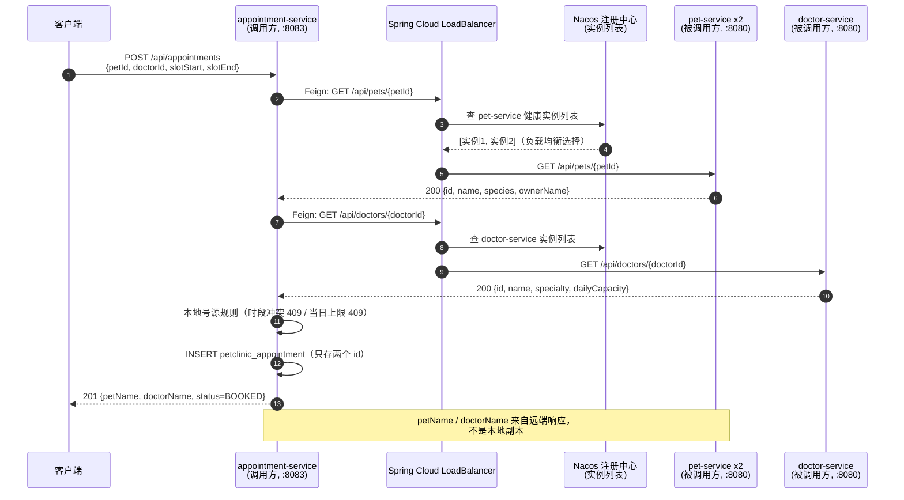

# 服务间同步调用链路（第 08 周 · OpenFeign）

> 作业要求：在 `docs/service-communication.md` 画出调用链路，并明确**调用方、被调用方和接口路径**。

## 一、选择的跨服务业务流程

**创建预约**：用户向 appointment-service 提交预约请求时，必须先确认「宠物存在」和「医生存在且当日号源未满」——这两类数据分别是 pet-service 和 doctor-service 的独占数据（三库三账号，禁止跨库访问），appointment-service 本地数据库里最多保存两个 ID，不存任何副本。所以这是一个**必须跨服务完成**的同步流程，且校验必须发生在本地写库**之前**。

## 二、调用链路图



## 三、调用方 / 被调用方 / 接口路径

| # | 调用方 | 被调用方 | 接口路径 | 触发时机 | 失败处理 |
|---|---|---|---|---|---|
| 1 | appointment-service（`PetClient` 门面 → `PetFeignClient`） | pet-service | `GET /api/pets/{id}` | 创建预约前校验宠物存在（强依赖） | 404 → 本接口返回 404；其他失败 → 503；**两种情况都不写库** |
| 2 | appointment-service（`DoctorClient` 门面 → `DoctorFeignClient`） | doctor-service | `GET /api/doctors/{id}` | 创建预约前校验医生存在并取每日号源上限（强依赖） | 同上 |
| 3 | appointment-service（同 1、2 弱依赖调用） | pet / doctor service | 同上 | 查询/取消预约时增强展示字段（petName / doctorName） | 弱依赖：失败降级为 null，业务不中断 |

- **代码位置（调用方）**：`services/appointment-service/src/main/java/com/zjgsu/njb/appointment/remote/`
  - `PetFeignClient.java` / `DoctorFeignClient.java` —— `@FeignClient(name = "pet-service" / "doctor-service")`，按**服务名**调用，不写死容器 IP；
  - `PetClient.java` / `DoctorClient.java` —— 门面，把 `FeignException` 翻译成业务异常（404 / 503）。
- **代码位置（被调用方）**：`services/pet-service/.../web/PetController.java`、`services/doctor-service/.../web/DoctorController.java`。

## 四、调用细节与失败语义

| 项目 | 配置 |
|---|---|
| 调用方式 | OpenFeign 声明式客户端（`spring-cloud-starter-openfeign` + `@EnableFeignClients`） |
| 地址解析 | Nacos 注册中心（分组 PERSONAL_GROUP）+ Spring Cloud LoadBalancer 按服务名取实例 |
| 负载均衡 | pet-service 可多实例运行（`--scale pet-service=2`），轮询分发，见 compose.lb.yaml |
| 连接超时 | 3000 ms（`spring.cloud.openfeign.client.config.default.connect-timeout`） |
| 读取超时 | 5000 ms（`read-timeout`） |
| 远端 404 | `FeignException.NotFound` → `ResourceNotFoundException` → 调用方接口返回 **404** |
| 远端 5xx / 连接失败 / 超时 | `FeignException` → `DependencyUnavailableException` → 返回 **503** |
| 实例列表为空 | LoadBalancer 抛无实例异常 → **503**（与远端宕机同等处理） |

**核心原则：任何校验失败都不会被当成业务成功。** 校验全部通过后才执行本地 INSERT，因此 404 / 409 / 503 时预约表零新增。已知局限如实说明：如果失败发生在**本地写库之后**（例如写库超时、响应断连），客户端看到失败但数据库可能已提交，结果未知——需要补偿机制（本地消息表 / Seata）才能闭环，本课程阶段未引入，已在文档标注。

## 五、端到端验证

```bash
# 从仓库根目录运行（pet-service 自动以 2 实例启动）
bash scripts/e2e-test.sh
```

脚本覆盖：多实例注册（Nacos 中 pet-service 实例数 = 2）→ 跨服务创建预约 201（响应含远端取回的宠物名/医生名）→ 两个 pet 实例日志均出现 `[LB]` 服务记录（负载均衡可证明）→ 停掉全部 pet 实例后创建预约 503 且预约表零新增 → 恢复实例后重新 201。
